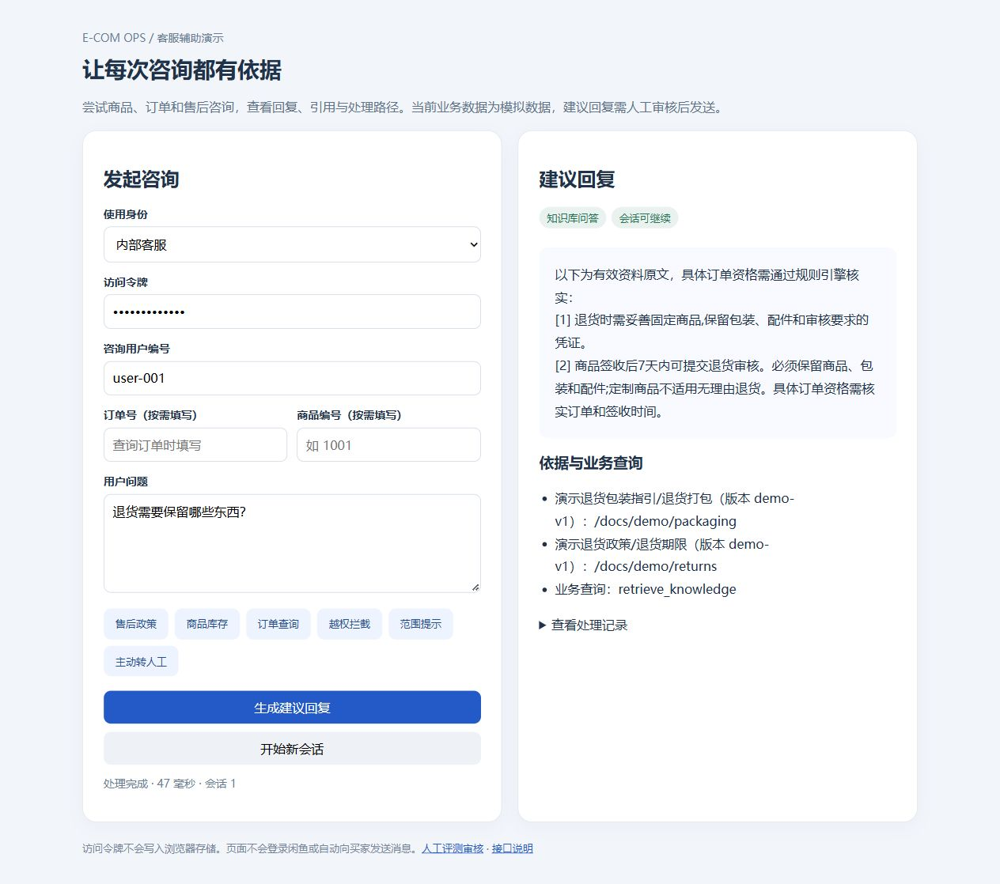
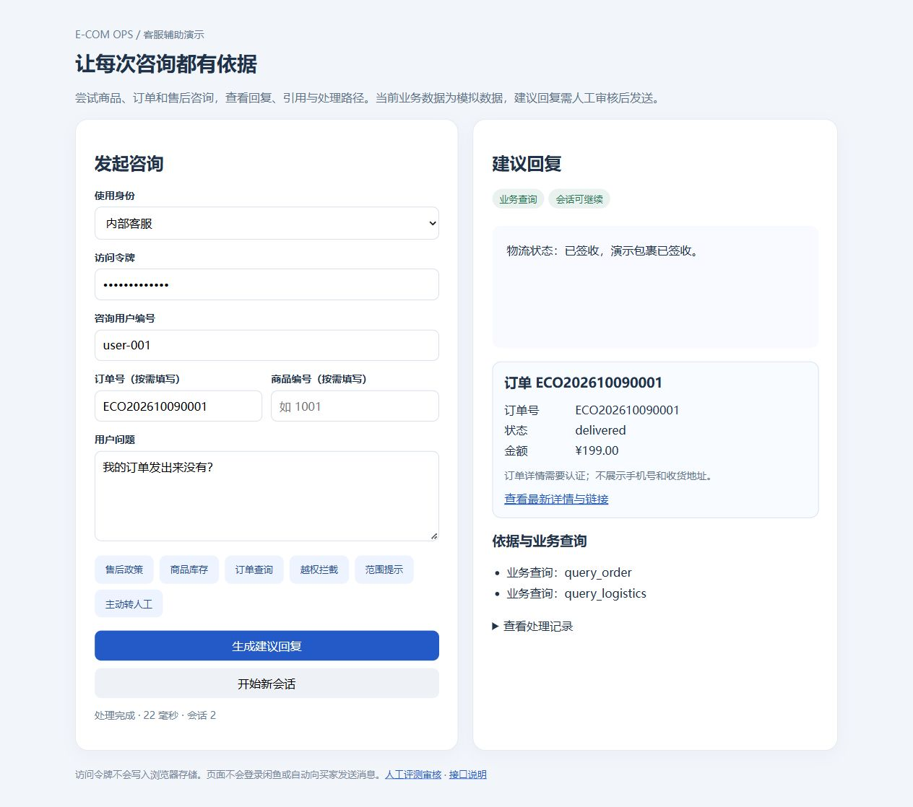

# E-com Ops 电商客服辅助系统

基于 FastAPI、SQLAlchemy、LangGraph 和 MCP 的电商客服辅助项目，覆盖商品/订单/物流查询、售后知识问答、人工接管与受控操作。支持离线演示，也可配置百炼 Embedding 与通义千问进行真实模型评测。

本项目使用模拟业务数据和合成演示政策，定位为可复现的工程演示；真实平台登录、业务同步及生产 SLA 尚未完成验证。

## 快速演示

推荐 Python 3.12。在项目目录执行：

```powershell
python -m pip install -r requirements.txt
python -m scripts.run_demo
```

打开 `http://127.0.0.1:8001/demo`，使用本地演示客服令牌 `dev-agent-key`。离线演示使用独立数据库，不需要百炼密钥，不产生模型 API 用量。

## 测试

```powershell
python -m pytest -q
```

截至 2026-10-11，本地回归 210 项通过。GitHub Actions 会在推送与 Pull Request 时运行测试；该检查不代表真实平台或生产环境验收。

配置示例见 `.env.example` 和 `.env.dashscope.example`。真实密钥仅保存于本地 `.env`；请勿提交密钥、业务数据库或运行日志。真实模型评测脚本会产生供应商 API 用量。

## 演示截图

下图为离线演示，使用模拟业务数据，访问令牌已隐藏。





## 实现与评测文档

最新路由改进、用户JWT认证、人工审核页面、演示入口、扩展知识库及并发/真实模型评测见 [docs/readiness.md](docs/readiness.md)。

一键离线演示：`python -m scripts.run_demo`，打开 `http://127.0.0.1:8001/demo`。使用独立模拟数据库，不修改原业务数据库。

面试评测数据、四组检索对照、故障注入、真实百炼冒烟结果与人工审核步骤见 [docs/interview-evaluation.md](docs/interview-evaluation.md)；设计取舍见 [docs/design-decisions.md](docs/design-decisions.md)。

咨询入口的敏感词拦截、业务分流、订单修改转人工、统一审计及实测结果见 [docs/consultation-pipeline.md](docs/consultation-pipeline.md)。

第六阶段灰度上线、停用接管、指标和复盘说明见 [docs/stage6.md](docs/stage6.md)。

第五阶段受控工单、退货草稿和通知待发送箱见 [docs/stage5.md](docs/stage5.md)。

本地只读MCP服务配置见 [docs/mcp.md](docs/mcp.md)。

LangGraph通过MCP执行工具的运行、回滚和验收见 [docs/mcp-workflow.md](docs/mcp-workflow.md)。

新增LangGraph只读工作流：`POST /api/v1/agent/query`，详见 [docs/agent-workflow.md](docs/agent-workflow.md)。

第四阶段的接口示例、规则语义、迁移/回滚和面试指标见 [docs/stage4.md](docs/stage4.md)。

RAG增强阶段的范围、启动、导入、评测和上线检查见 [docs/rag.md](docs/rag.md)。

百炼真实Embedding与通义千问生成服务的配置、联调及安全边界见 [docs/dashscope.md](docs/dashscope.md)。

查询改写、模型重排序和受限Self-RAG见 [docs/rag-enhancements.md](docs/rag-enhancements.md)。

## 启动

```powershell
python -m pip install -r requirements.txt
python scripts/seed.py
uvicorn app.main:app --reload
```

Swagger: `http://127.0.0.1:8000/docs`。测试账号使用 `Bearer dev-agent-key`，管理员审计接口使用 `Bearer dev-admin-key`。

## 第二阶段聊天接口

`POST /api/v1/chat` 接收 `user_external_id`、`message`、可选 `order_no` 和 `conversation_id`。系统按意图路由到 `query_product`、`query_order`、`query_logistics`，售后问题返回带政策版本的知识库来源；低置信度、查无数据或用户与订单不匹配时转人工。会话、消息和工具调用均落库。

## 第三阶段异步与人工协同

- `POST /api/v1/conversations/{id}/handoff`：创建携带上下文快照的人工工单，重复调用返回同一工单。
- `GET/PATCH /api/v1/tickets/{id}`：查看工单并按 `new -> processing -> waiting_user/resolved -> closed` 流转，状态变更需要管理员令牌。
- `POST /api/v1/tasks`：创建物流同步、通知或报表异步任务；`idempotency_key` 保证重试不重复创建。
- `POST /api/v1/tasks/{id}/retry`：重试失败任务，超过最大次数进入 `dead_letter`。

本地没有 Redis 时使用内存短期上下文和数据库任务表；配置 `.env` 中的 `REDIS_URL`、`CELERY_BROKER_URL`、`CELERY_RESULT_BACKEND` 后启用 Redis/Celery。`docker compose up --build` 会启动 API 与 Redis。

## SQL Server

生产环境将 `DATABASE_URL` 替换为 SQLAlchemy SQL Server 连接串，并用 Alembic 管理迁移；本地默认 SQLite 便于验收。
